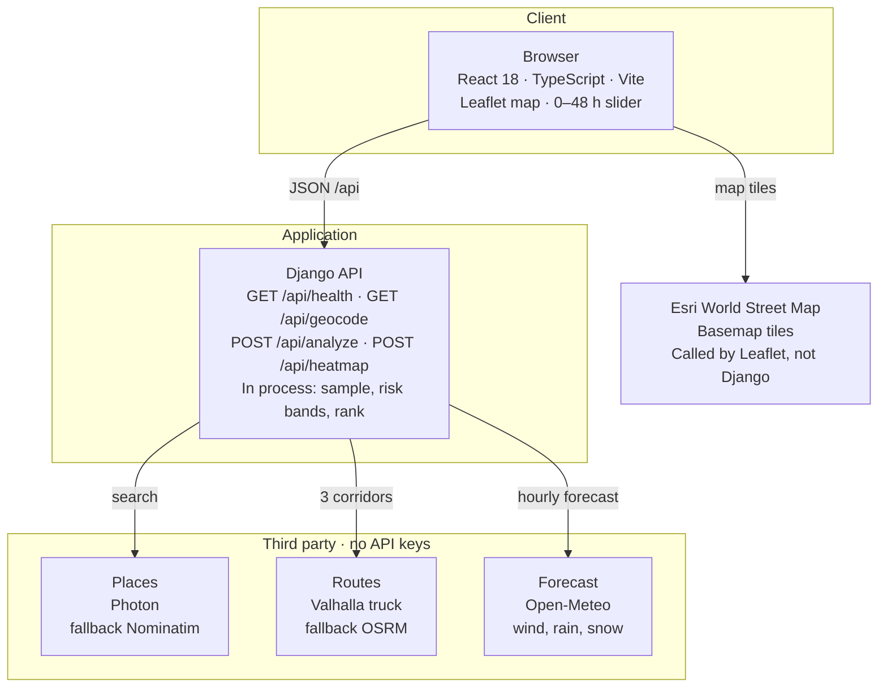

# Truckcast architecture

One React app and one Django process. The browser calls four of our endpoints. Django calls five public services. The map calls Esri directly. Nothing in this path needs an API key or a trip database.

| Own HTTP endpoints | Third-party services | API keys |
| --- | --- | --- |
| 4 | 6 | 0 |

Source: Truckcast repository. Production host: https://truckcast.onrender.com

## Own API

Locally, Vite on port 5173 proxies `/api` to Django on port 8000. On Render, gunicorn serves the built React app and these endpoints from the same container.

| Method | Path | When the browser calls it | What Django calls next |
| --- | --- | --- | --- |
| GET | `/api/health` | Render health check | Nothing |
| GET | `/api/geocode` | While a place name is typed | Photon, then Nominatim if Photon is empty |
| POST | `/api/analyze` | Compare routes | Valhalla or OSRM, then Open-Meteo |
| POST | `/api/heatmap` | Immediately after a successful plan | Open-Meteo for the corridor band |

## Third-party services

| Service | Job | Fallback | Who calls it | Default URL |
| --- | --- | --- | --- | --- |
| Photon | Place search | Nominatim | Django | photon.komoot.io |
| Nominatim | Place search | None | Django | nominatim.openstreetmap.org |
| Valhalla | Three truck corridors and arrival times | OSRM driving profile | Django | valhalla1.openstreetmap.de |
| OSRM | Driving route if Valhalla is down | None | Django | router.project-osrm.org |
| Open-Meteo | Hourly wind, rain, and snow | None | Django | api.open-meteo.com |
| Esri World Street Map | Basemap | None | Browser | server.arcgisonline.com |

Each URL can be overridden with `PHOTON_URL`, `NOMINATIM_URL`, `VALHALLA_URL`, `OSRM_URL`, or `OPEN_METEO_URL`.

## One Compare routes click

### Before the click

Typing an origin or destination sends `GET /api/geocode`. Results are cached in the Django process for 24 hours. A picked suggestion is sent later as coordinates, so analyze does not search again.

### POST /api/analyze

Django asks Valhalla for the truck profile plus two alternates. If the truck profile cannot route the pair, it retries the auto profile. If Valhalla returns nothing, OSRM supplies a driving route. Extra via-point requests run only when fewer than three distinct corridors came back. Arrival time at each checkpoint comes from Valhalla maneuver timing, spread along the road by distance.

Weather is then sampled every 10, 25, or 50 miles at that arrival time. Open-Meteo is called in batches of 80 coordinates and cached for 20 minutes. Risk and the recommendation are computed in process. No Travel miles are compared first, then Severe, High, average risk, and travel time.

### POST /api/heatmap

After the routes are drawn, the browser sends the three corridor lines. Django samples the road plus a band on each side, up to 220 cells, and requests one hourly forecast covering hour 0 through hour 48. Moving the slider or pressing Play only changes which stored hour is drawn. It does not call Open-Meteo again.

## Stack and hosting

| Layer | Local | Production |
| --- | --- | --- |
| Interface | React 18, TypeScript, Vite 5, Leaflet | Same build, served as static files |
| API | Django 5 on port 8000 | gunicorn, 2 workers, 120 s timeout |
| Static files | Vite dev server | WhiteNoise, from the frontend build |
| Timezone data | macOS zone database | tzdata package inside the image |
| Host | Two terminals | Render free Docker service, Oregon |
| Persistence | None for trips | None for trips. In-memory caches only |

SQLite is configured for Django and is not used by routing. There is no user account, no saved trip, and no paid routing or weather account. A free Render instance sleeps after inactivity, so the first request after that waits for the container to wake.
